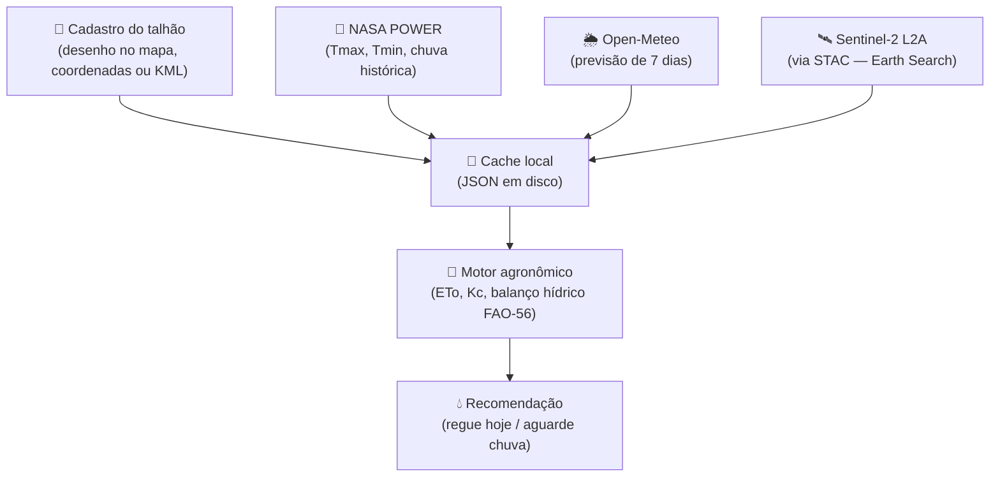
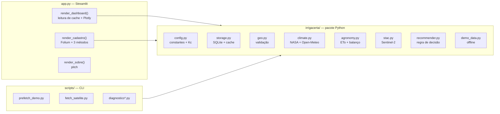

# 💧 IrrigaCerta

> **Assistente de irrigação por talhão baseado em satélite, clima e agronomia — para resiliência hídrica no agro.**

[](https://hackathon-eagro2026.streamlit.app/)
[](https://www.python.org/)
[](https://streamlit.io/)
[](https://www.copernicus.eu/)
[](https://e-agro.com.br/)
[](LICENSE)

Projeto desenvolvido para o **Hackathon E-Agro 2026** (Salvador/BA, 12–14 de novembro de 2026), na temática de **Resiliência Hídrica no Agro**.

**🌐 Demo ao vivo:** [hackathon-eagro2026.streamlit.app](https://hackathon-eagro2026.streamlit.app/)

---

## 📖 Sumário

- [Sobre o projeto](#-sobre-o-projeto)
- [Demo ao vivo](#-demo-ao-vivo)
- [Contexto do hackathon](#-contexto-do-hackathon)
- [O problema](#-o-problema)
- [A solução](#-a-solução)
- [Como funciona](#-como-funciona)
- [Arquitetura](#-arquitetura)
- [Funcionalidades](#-funcionalidades)
- [Screenshots](#-screenshots)
- [Stack tecnológico](#-stack-tecnológico)
- [Fontes de dados](#-fontes-de-dados)
- [Estrutura do repositório](#-estrutura-do-repositório)
- [Instalação](#-instalação)
- [Uso](#-uso)
- [Configuração](#-configuração)
- [Deploy no Streamlit Cloud](#-deploy-no-streamlit-cloud)
- [Metodologia agronômica](#-metodologia-agronômica)
- [Metodologia computacional](#-metodologia-computacional)
- [Impacto esperado](#-impacto-esperado)
- [Prova de Conceito (POC)](#-prova-de-conceito-poc)
- [Pitch](#-pitch)
- [Limitações conhecidas](#-limitações-conhecidas)
- [Roadmap](#-roadmap)
- [Equipe](#-equipe)
- [Licença](#-licença)
- [Agradecimentos](#-agradecimentos)

---

## 🌱 Sobre o projeto

O **IrrigaCerta** é uma aplicação web que responde a uma pergunta simples e crítica para o produtor rural:

> **"Devo irrigar hoje? Quanto?"**

A resposta combina três camadas de informação abertas e gratuitas:

1. **Satélite Sentinel-2** → índices de vegetação e umidade (NDVI / NDMI) medidos do espaço.
2. **Clima** (NASA POWER + Open-Meteo) → temperatura, chuva histórica e previsão de 7 dias.
3. **Agronomia** → balanço hídrico do solo segundo a metodologia **FAO-56**, com coeficiente de cultura (Kc) por estádio fenológico.

O resultado é uma recomendação em **linguagem leiga**, com lâmina (mm) e tempo de irrigação convertido para o sistema do produtor (gotejamento, aspersão, pivô).

O projeto foi desenhado para funcionar em três modos:

- 🟢 **Online** — busca dados reais ao vivo.
- 💾 **Cache** — dados pré-carregados, ideal para demo.
- 🔌 **Offline (demo mode)** — sem internet, lê apenas o cache local.

---

## 🌐 Demo ao vivo

**[▶️ Acesse o IrrigaCerta em produção](https://hackathon-eagro2026.streamlit.app/)**

O app está deployado no **Streamlit Community Cloud** e roda em **modo demo** (offline), com dois talhões pré-carregados para demonstração imediata:

| Talhão | Cultura | Cenário | Recomendação |
|---|---|---|---|
| **Talhão A** | Tomate (Nilo Coelho/PE) | Solo em déficit hídrico | 🔴 **"Regue hoje"** |
| **Talhão B** | Milho (Nilo Coelho/PE) | Chuva prevista em 48h | 🟦 **"Espere a chuva"** |

> ⚠️ **Modo demo**: para garantir estabilidade na apresentação, a versão pública roda com `IRRIGACERTA_DEMO_MODE=1` — lê apenas o cache local, sem chamadas externas. Para habilitar buscas ao vivo, veja [Deploy no Streamlit Cloud](#-deploy-no-streamlit-cloud).

**O que você pode testar na demo:**
- ✅ Navegar pelos 2 talhões pré-carregados
- ✅ Ver recomendação, barra de status e gráficos
- ✅ Trocar entre 15 estilos de mapa
- ✅ Cadastrar novos talhões (por desenho, coordenadas ou KML)
- ⚠️ "Carregar clima" e "Buscar satélite" exigem modo ao vivo (ver acima)

---

## 🎯 Contexto do hackathon

| Item | Detalhe |
|---|---|
| **Evento** | Hackathon E-Agro 2026 |
| **Datas** | 12–14 de novembro de 2026 |
| **Local** | Centro de Convenções de Salvador (BA) |
| **Premiação** | R$ 10.000,00 |
| **Tema principal** | Resiliência Hídrica no Agro |
| **Formato** | 3 dias — imersão, protótipo, demo day |
| **Organização** | E-Agro 2026 + Hub Semear / FAEB / SENAR |

### Subtemas atendidos

O IrrigaCerta se encaixa diretamente em **3 dos 5 subtemas** do edital:

- ✅ **1. Irrigação Inteligente e Uso Eficiente da Água** — recomendação de lâmina e frequência de irrigação baseada em dados de satélite e clima.
- ✅ **2. Monitoramento, Dados e Inteligência Hídrica** — satélite + clima + balanço hídrico em dashboard explicável.
- ✅ **3. Gestão, Prevenção de Perdas e Adaptação às Secas** — alertas de déficit e linguagem adaptada ao produtor leigo.

### Por que esta solução

- **Problema real**: o produtor irriga "no feeling", desperdiça água/energia, ou perde safra por atraso de dois dias.
- **MVP viável em 3 dias**: dashboard com mapa + recomendação + gráficos, sem hardware.
- **Diferencial**: não depende de sensores, usa dados abertos, modelo explicável (não caixa-preta).
- **Caminho de continuidade**: POC com cooperativa, integração com Hub Semear/FAEB/SENAR.

---

## ⚠️ O problema

A disponibilidade de água é um fator estratégico para a produção agropecuária brasileira. Eventos climáticos extremos, estiagens prolongadas e o desperdício nos sistemas produtivos tornam necessária a criação de tecnologias acessíveis.

No semiárido brasileiro (Petrolina/PE e Juazeiro/BA, foco do projeto), o produtor irrigante enfrenta três dores recorrentes:

| Dor | Consequência |
|---|---|
| **Quando irrigar?** — decisão "no feeling" | Estresse hídrico e perda de produtividade |
| **Quanto irrigar?** — sem medição de umidade do solo | Desperdício de água e energia elétrica |
| **Onde perde água?** — sem diagnóstico do sistema | Custo operacional maior e menor sustentabilidade |

Soluções existentes no mercado são caras (sensores físicos), proprietárias ou focadas em grandes propriedades. Faltam ferramentas **acessíveis**, **explicáveis** e que usem **dados abertos**.

---

## 💡 A solução

O **IrrigaCerta** entrega **recomendação diária de irrigação por talhão**, sem necessidade de sensores físicos, usando exclusivamente dados abertos:

- **Entrada:** centroide do talhão, cultura, data de plantio, textura do solo, sistema de irrigação e vazão.
- **Processamento:** balanço hídrico diário + índices de satélite + previsão de chuva.
- **Saída:** recomendação clara ("Regue hoje — 12 mm ≈ 2,2 h"), barras de status e gráficos explicativos.

**Diferenciais técnicos:**

- ✅ Sem dependência de hardware instalado no campo.
- ✅ Modelo **explicável** (não é caixa-preta) — o produtor vê o porquê da recomendação.
- ✅ Funciona **offline** após a primeira busca (cache em JSON).
- ✅ Todo o processamento de satélite é feito em **subprocesso isolado** — falhas do GDAL não derrubam a aplicação.
- ✅ Linguagem adaptada ao produtor leigo (não para o técnico).

### Não-escopo (decisões conscientes)

- ❌ **Não construímos hardware** — sensores IoT são caros e complexos para 3 dias.
- ❌ **Não é "app genérico de gestão"** — foco em **decisão hídrica**, não em finanças, estoque ou CRM.
- ❌ **Não usamos IA/ML sem dados** — o modelo é FAO-56 (consolidado e explicável), não caixa-preta.
- ❌ **Um problema, uma persona, um MVP** — produtor irrigante do semiárido baiano.
- ✅ **Demo offline** — a apresentação roda do cache, sem depender de internet.

---

## ⚙️ Como funciona



**Etapa a etapa:**

1. **Cadastro** — o produtor delimita o talhão por desenho no mapa, coordenadas + área, ou upload de GeoJSON/KML.
2. **Coleta** — o sistema busca clima histórico (NASA POWER), previsão (Open-Meteo) e índices de satélite (Sentinel-2), salvando tudo em cache.
3. **Processamento** — o motor agronômico calcula ETo, Kc por estádio e o balanço hídrico diário (Dr, TAW, RAW).
4. **Recomendação** — a regra decide entre "regar hoje", "aguardar chuva" ou "solo em boa umidade", com lâmina convertida para o sistema do produtor.

---

## 🏗 Arquitetura

O projeto segue uma arquitetura **monolítica em camadas**, com separação clara entre lógica de domínio e apresentação. A escolha por Streamlit (em vez de React + FastAPI) foi deliberada para um hackathon de 3 dias: produtividade > separação completa.



**Decisões arquiteturais notáveis:**

| Decisão | Motivo |
|---|---|
| Satélite em **subprocesso** | Contorna segfault do GDAL no Windows; falha isolada |
| **Cache em JSON** (não em memória) | Demo offline + retomada rápida entre reruns |
| **SQLite** para talhões | Zero setup, arquivo único, fácil de versionar em dev |
| Tiles passados **no construtor** do `folium.Map` | Evita bug do Leaflet Draw que não finaliza o polígono |
| `draw_options` no `Draw()` | Correção definitiva do mesmo bug (issue #178 do streamlit-folium) |

---

## ✨ Funcionalidades

### Cadastro de talhão
- 🎨 **Desenho no mapa** (polígono/retângulo) com tiles de satélite.
- 📍 **Coordenadas + área** (método 100% confiável, gera quadrado).
- 📁 **Upload de GeoJSON/KML** (Google Earth, QGIS, etc.).
- ✅ Validação de auto-interseção e área.
- ⚠️ Aviso quando o talhão é grande demais (> 500 ha).

### Dashboard
- 💧 **Recomendação em linguagem leiga** com explicação do "porquê".
- 📊 **Barra de progresso** de água no solo (Dr / TAW).
- 🛰️ **Gráfico de NDMI** com faixas seca/moderada/úmida.
- 💧 **Gráfico de balanço hídrico** com zonas segura/alerta.
- 📅 Datas em **português** (`21/out`) sem depender de locale.
- ❓ **Expanders explicativos** — "O que é NDMI?", "O que significa TAW?".

### Gestão
- 🗑️ Excluir talhão + caches associados.
- 🔄 Re-buscar clima / satélite manualmente.
- 🗺️ Seletor de **15 estilos de mapa** (Google, Esri, OSM, CARTO, Sentinel-2).
- 💾 Modo **offline** (`IRRIGACERTA_DEMO_MODE=1`).

---

## 📸 Screenshots

> **Nota:** substitua os placeholders abaixo por imagens reais do app.

### Dashboard principal


*Mapa de satélite + recomendação em linguagem leiga + barra de nível de água no solo.*

### Gráfico de balanço hídrico


*Linha de consumo de água, com faixas coloridas mostrando zona segura (verde) e de alerta (vermelho).*

### Gráfico de umidade via satélite (NDMI)


*Tendência de umidade das plantas vista do espaço (Sentinel-2).*

### Cadastro por desenho


*Polígono desenhado sobre lavoura real.*

---

## 🛠 Stack tecnológico

| Camada | Tecnologia | Versão | Por quê |
|---|---|---|---|
| **App** | Streamlit | 1.33.0 | Prototipagem rápida, estado de sessão |
| **Mapas** | Folium + streamlit-folium | 0.16 / 0.20 | Leaflet robusto, tiles abertos |
| **Gráficos** | Plotly | ≥ 5.20 | Responsivo, interativo, PT-BR sem locale |
| **Raster** | rasterio | ≥ 1.3 | Leitura de COG (Sentinel-2) |
| **Geometria** | Shapely + pyproj | ≥ 2.0 / 3.6 | Validação e projeção |
| **Dados** | pandas + numpy | ≥ 2.2 / 1.26 | Séries e agregação |
| **Persistência** | SQLite | (nativo) | Zero setup |
| **Config** | python-dotenv | ≥ 1.0 | `.env` versionável |
| **Deploy** | Streamlit Community Cloud | — | Deploy gratuito, HTTPS, URL pública |

> **Versões pinadas** (`streamlit==1.33.0`, `streamlit-folium==0.20.0`, `folium==0.16.0`) são necessárias para o correto funcionamento do Leaflet Draw no cadastro. Ver [Limitações conhecidas](#-limitações-conhecidas).

---

## 🛰 Fontes de dados

| Fonte | O que fornece | Acesso | Custo | Referência |
|---|---|---|---|---|
| **Sentinel-2 L2A** | NDVI, NDMI (bandas B04, B08, B11, SCL) | [Earth Search (STAC)](https://earth-search.aws.element84.com/v1) | Gratuito, sem chave | [Copernicus](https://www.copernicus.eu/) |
| **NASA POWER** | Tmax, Tmin, chuva, umidade, vento, radiação | [power.larc.nasa.gov](https://power.larc.nasa.gov/) | Gratuito, sem chave | [NASA LaRC](https://power.larc.nasa.gov/) |
| **Open-Meteo** | Previsão de chuva e temperatura (7 dias) | [open-meteo.com](https://open-meteo.com/) | Gratuito, sem chave | [Open-Meteo](https://open-meteo.com/) |
| **Tiles de mapa** | Satélite, híbrido, ruas, topográfico | Google / Esri / OSM / CARTO / EOX | Gratuito (ver licenças) | Ver `TILE_PROVIDERS` no `app.py` |

### Fórmulas

**NDVI** (Normalized Difference Vegetation Index) — vigor da vegetação:

$$
\mathrm{NDVI} = \frac{\mathrm{NIR} - \mathrm{RED}}{\mathrm{NIR} + \mathrm{RED}}
$$

**NDMI** (Normalized Difference Moisture Index) — umidade da vegetação:

$$
\mathrm{NDMI} = \frac{\mathrm{NIR} - \mathrm{SWIR}}{\mathrm{NIR} + \mathrm{SWIR}}
$$

**ETo** (Hargreaves-Samani) — evapotranspiração de referência:

$$
\mathrm{ETo} = 0{,}0023 \cdot R_a \cdot (T_{\text{mean}} + 17{,}8) \cdot \sqrt{T_{\max} - T_{\min}}
$$

**Balanço hídrico (FAO-56)** — modelo tipo "balde":

$$
D_{r,i} = \max\!\left(0,\ \min\!\left(\mathrm{TAW},\ D_{r,i-1} - P_i - I_i + \mathrm{ETc}_i\right)\right)
$$

$$
\mathrm{ETc}_i = \mathrm{ETo}_i \cdot K_c
\qquad
\mathrm{TAW} = (\theta_{\mathrm{FC}} - \theta_{\mathrm{WP}}) \cdot Z_r
\qquad
\mathrm{RAW} = p \cdot \mathrm{TAW}
$$

> Símbolos: $D_r$ = depleção atual (mm), $P$ = precipitação, $I$ = irrigação, $\mathrm{ETc}$ = evapotranspiração da cultura, $K_c$ = coeficiente de cultura, $Z_r$ = profundidade radicular, $\theta_{\mathrm{FC}}$, $\theta_{\mathrm{WP}}$ = umidade na capacidade de campo e no ponto de murcha, $p \approx 0{,}5$.

---

## 📂 Estrutura do repositório

```
irrigacerta/
│
├── app.py                      ← aplicação Streamlit (UI)
├── requirements.txt            ← dependências Python
├── .env.example                ← template de variáveis de ambiente
├── .gitignore
├── README.md                   ← este arquivo
├── LICENSE
│
├── irrigacerta/                ← pacote Python (lógica de domínio)
│   ├── __init__.py
│   ├── config.py               ← constantes, tabelas Kc, TAW
│   ├── storage.py              ← SQLite + cache JSON
│   ├── geo.py                  ← validação + UTM dinâmico
│   ├── climate.py              ← NASA POWER + Open-Meteo
│   ├── agronomy.py             ← ETo, Kc, balanço hídrico
│   ├── stac.py                 ← Sentinel-2 via STAC
│   ├── recommender.py          ← regra de decisão
│   └── demo_data.py            ← talhões sintéticos
│
├── scripts/                    ← CLI executáveis
│   ├── prefetch_demo.py        ← aquece cache (clima + satélite)
│   ├── fetch_satelite.py       ← busca em subprocesso
│   ├── diagnostico.py          ← diagnóstico das APIs
│   ├── diagnostico_satelite.py ← debug de cena STAC
│   └── triagem_coords.py       ← checa vegetação em coords
│
├── data/                       ← (git-ignored)
│   ├── cache/                  ← JSONs de clima e satélite
│   └── irrigacerta.db          ← SQLite com talhões
│
└── docs/
    └── screenshots/            ← imagens do README
```

---

## 🚀 Instalação

### Pré-requisitos

- **Python 3.11+** (testado em 3.12)
- **pip** + **venv**
- Internet (para primeira busca); não é necessário após o cache.

### Passo a passo

```bash
# 1. Clone o repositório
git clone https://github.com/<seu-usuario>/irrigacerta.git
cd irrigacerta

# 2. Crie e ative o ambiente virtual
python -m venv .venv
# Windows:
.venv\Scripts\activate
# Linux/macOS:
source .venv/bin/activate

# 3. Instale as dependências
pip install -r requirements.txt

# 4. Configure as variáveis de ambiente
cp .env.example .env
# Edite .env conforme necessário (ver seção Configuração)

# 5. (Opcional) Aqueça o cache para demo offline
python -m scripts.prefetch_demo

# 6. Suba o app
streamlit run app.py
```

Acesse **http://localhost:8501**.

---

## 🎮 Uso

### Fluxo rápido

1. **Cadastro** → escolha um dos três métodos para definir o talhão.
2. **Dashboard** → selecione o talhão no dropdown.
3. Clique em **🌦️ Carregar clima** → busca NASA POWER + Open-Meteo (~10 s).
4. Clique em **🛰️ Buscar satélite** → busca Sentinel-2 (~30 s com cache, 5 min sem).
5. Veja a **recomendação** e os **gráficos**.
6. Use **⚙️ Gerenciar este talhão** para excluir, re-buscar ou atualizar.

### Modo offline (para Demo Day)

```bash
# 1. Com internet, aqueça o cache
python -m scripts.prefetch_demo
python -m scripts.fetch_satelite <talhao_id> 90

# 2. Desligue o modo online
# .env:
IRRIGACERTA_DEMO_MODE=1

# 3. Suba o app — 100% offline
streamlit run app.py
```

O app abre instantaneamente, sem chamadas externas.

### Scripts CLI

```bash
# Diagnóstico geral (APIs de clima, STAC, conectividade)
python -m scripts.diagnostico

# Diagnóstico específico de satélite
python -m scripts.diagnostico_satelite <talhao_id>

# Buscar satélite para um talhão
python -m scripts.fetch_satelite <talhao_id> 90

# Pré-carregar todos os talhões (véspera do Demo Day)
python -m scripts.prefetch_demo
```

---

## ⚙️ Configuração

### Variáveis de ambiente (`.env` local) e Secrets (Streamlit Cloud)

| Variável | Valores | Padrão | Efeito |
|---|---|---|---|
| `IRRIGACERTA_DEMO_MODE` | `0` / `1` | `1` | `1` = só cache (offline); `0` = busca dados reais |

**Ordem de prioridade na leitura:**

1. **Streamlit Secrets** (`st.secrets`) — usado no Streamlit Cloud
2. Variável de ambiente (`export` / `set`)
3. Arquivo `.env` (local)
4. Default: `"1"` (demo)

### Constantes (`irrigacerta/config.py`)

| Constante | Padrão | Descrição |
|---|---|---|
| `STAC_COLLECTIONS` | `("sentinel-2-c1-l2a", "sentinel-2-l2a")` | Coleções STAC (fallback em ordem) |
| `MAX_NUVEM_DEFAULT` | `70` | Limiar de nuvem (%) para aceitar uma cena |
| `MAX_CENAS_PROCESSAR` | `3` | Quantas cenas (mais limpas) processar |
| `DIAS_SATELITE_DEFAULT` | `90` | Janela de busca de cenas (dias) |
| `NASA_POWER_URL` | `power.larc.nasa.gov` | Endpoint NASA POWER |
| `OPEN_METEO_URL` | `api.open-meteo.com` | Endpoint Open-Meteo |

### Parâmetros agronômicos

A tabela de **Kc por cultura** (`config.KC`) e a **capacidade de retenção do solo** (`config.TAW_POR_METRO`) são aproximações FAO-56 validadas para o MVP. Para produção, recomenda-se calibrar com dados de campo (ver [POC](#-prova-de-conceito-poc)).

---

## 🚀 Deploy no Streamlit Cloud

O app está disponível em **[hackathon-eagro2026.streamlit.app](https://hackathon-eagro2026.streamlit.app/)**. Abaixo, como replicar o deploy.

### Pré-requisitos

- Repositório público no GitHub
- Conta em [share.streamlit.io](https://share.streamlit.io) (gratuita)

### Passo a passo

1. **Push do código para o GitHub**
   ```bash
   git add .
   git commit -m "Deploy inicial do IrrigaCerta"
   git push origin main
   ```

2. **Conecte o repositório no Streamlit Cloud**
   - Acesse [share.streamlit.io](https://share.streamlit.io) → **New app**
   - Selecione o repositório, branch `main` e arquivo `app.py`
   - Python version: **3.12**

3. **Configure os secrets** (Settings → Secrets)
   ```toml
   IRRIGACERTA_DEMO_MODE = "1"
   ```
   - `"1"` = **modo demo** (recomendado para apresentação; lê só cache)
   - `"0"` = **modo ao vivo** (busca satélite/clima ao vivo; mais lento)

4. **Deploy** — clique em **Deploy** e aguarde 2–5 minutos.

### Comportamento no Cloud

| Aspecto | Detalhe |
|---|---|
| **Modo padrão** | Demo (`IRRIGACERTA_DEMO_MODE=1`) — previsível e rápido |
| **Talhões pré-carregados** | `demo_data.ensure_demo_talhoes()` cria Talhão A (tomate, déficit) e Talhão B (milho, chuva) no primeiro acesso |
| **Persistência** | O diretório `data/` é **efêmero** — caches e talhões criados por visitantes são perdidos entre reinícios |
| **Sleep** | Free tier dorme após ~15 min inativo; primeira carga após sleep leva ~30 s |
| **GDAL segfault** | **Não ocorre no Cloud** (Linux); o workaround do subprocesso é específico para Windows |
| **Rasterio** | Funciona out-of-the-box no Cloud (wheels Linux trazem GDAL estático) |
| **RAM** | 1 GB (free tier) — suficiente para o app em modo demo |

### Habilitar buscas ao vivo no Cloud (opcional)

Para testar `Carregar clima` / `Buscar satélite` na versão pública:

1. **Settings → Secrets**:
   ```toml
   IRRIGACERTA_DEMO_MODE = "0"
   ```
2. Reinicie o app.

> ⚠️ **Atenção**: em modo ao vivo, o primeiro fetch de satélite pode levar 3–5 min e consumir RAM (~500 MB). Para o pitch, prefira o modo demo com cache pré-aquecido.

### Ajuste no `config.py` para ler Secrets

Para funcionar tanto localmente (`.env`) quanto no Cloud (`st.secrets`), o `config.py` usa:

```python
import os
from pathlib import Path
from dotenv import load_dotenv

BASE_DIR = Path(__file__).resolve().parent.parent
load_dotenv(BASE_DIR / ".env")


def _get_secret(key: str, default: str = "") -> str:
    """Prioridade: Streamlit Secrets > env > .env > default."""
    try:
        import streamlit as st
        if key in st.secrets:
            return str(st.secrets[key])
    except Exception:
        pass
    return os.getenv(key, default)


DEMO_MODE = _get_secret("IRRIGACERTA_DEMO_MODE", "1") == "1"
```

---

## 🌾 Metodologia agronômica

### ETo (Hargreaves-Samani)

Escolhida por precisar apenas de Tmax e Tmin (NASA POWER fornece), sem exigir radiação solar confiável. Apropriada para o MVP; Penman-Monteith pode ser adicionada na POC.

### Kc (FAO-56)

Tabela com 4 estádios fenológicos (inicial, desenvolvimento, médio, final):

| Cultura | $K_{c,\text{ini}}$ | $K_{c,\text{mid}}$ | $K_{c,\text{fim}}$ | Duração (dias) |
|---|---|---|---|---|
| Tomate | 0,60 | 1,15 | 0,80 | 30+40+40+25 |
| Milho | 0,30 | 1,20 | 0,35 | 30+40+30+25 |
| Feijão | 0,40 | 1,15 | 0,35 | 20+30+30+20 |
| Uva | 0,30 | 0,80 | 0,45 | 30+60+60+30 |
| Soja | 0,40 | 1,15 | 0,50 | 25+35+50+20 |
| Café | 0,90 | 0,95 | 0,95 | 60+90+120+60 |

> ⚠️ Kc do café é **debatido na literatura** (varia entre 0,85 e 1,10). Validar com mentor antes de usar em produção.

### Balanço hídrico

Modelo tipo "balde", com recarga por chuva (e irrigação, quando conhecida) e descarga por ETc. A irrigação é recomendada quando $D_r \geq \mathrm{RAW}$ e não há chuva prevista $\geq 5\ \text{mm}$ em 48 h.

---

## 💻 Metodologia computacional

### Pipeline de satélite

1. **Busca STAC** (`POST /search` no Earth Search) → cenas com `eo:cloud_cover < MAX_NUVEM_DEFAULT`.
2. **Ordenação por nuvem** → processa as mais limpas primeiro (não as mais recentes).
3. **Download via `requests`** → COG completo da banda (~100 MB por banda no tile inteiro).
4. **Leitura local com `rasterio`** → janela do polígono, `out_shape=(100,100)`, resampling bilinear/nearest.
5. **Máscara SCL** → só classes 4 (veg), 5 (solo), 6 (água).
6. **Máscara polígono** → `geometry_mask` reprojeta para o CRS da cena.
7. **Cálculo dos índices** → NDVI e NDMI médios no polígono.
8. **Cache** → JSON em `data/cache/sat_<talhao_id>.json`.

### Por que não `stackstac`/`xarray`?

Testamos `stackstac` em Windows e obtivemos **segfault nativo do GDAL** (`-1073740791` / `0xC0000409`) durante leitura HTTP de COGs. A solução foi:

1. **Baixar via `requests`** (HTTP do Python, estável).
2. **Abrir via `rasterio`** em arquivo local (GDAL local, estável).
3. **Rodar em subprocesso** para isolar falhas eventuais do `rasterio`.

O resultado é robusto: um segfault isolado **não derruba o Streamlit**, e o log completo fica disponível no expander.

### Estrutura de dados

**SQLite** (`data/irrigacerta.db`):

```sql
CREATE TABLE talhoes (
    id TEXT PRIMARY KEY,
    nome TEXT NOT NULL,
    geometry TEXT NOT NULL,       -- GeoJSON
    area_ha REAL NOT NULL,
    cultura TEXT NOT NULL,
    data_plantio TEXT NOT NULL,
    textura_solo TEXT NOT NULL,
    sistema_irrigacao TEXT NOT NULL,
    vazao_mm_h REAL NOT NULL,
    lat REAL NOT NULL,
    lon REAL NOT NULL,
    criado_em TEXT NOT NULL
);
```

**Cache JSON** (`data/cache/clima_<id>.json`, `data/cache/sat_<id>.json`):

```json
{
  "historico": {
    "2026-10-01": { "tmax": 33.0, "tmin": 22.0, "chuva": 0.0 },
    "2026-10-02": { "tmax": 34.5, "tmin": 23.0, "chuva": 2.1 }
  },
  "previsao": {
    "2026-10-24": { "chuva": 12.0, "tmax": 35.0, "tmin": 23.5 }
  }
}
```

---

## 📊 Impacto esperado (metas a validar em POC)

O IrrigaCerta tem potencial para gerar impacto em três dimensões. As metas abaixo são **hipóteses a validar** na POC (5 propriedades / 60 dias) — **não são promessas**.

### Água e energia
- **Redução de consumo** de água e energia elétrica sem perda de produtividade.
- **Detecção precoce** de déficit hídrico antes do estresse visível das plantas.

### Produtividade e renda
- **Menor risco de perda de safra** por atraso na irrigação.
- **Priorização** de onde vale investir em sensores (onde o modelo não é suficiente).

### Sustentabilidade e gestão
- **Dados abertos e gratuitos** (Sentinel-2, NASA POWER, Open-Meteo) — custo próximo de zero.
- **Explicabilidade**: o produtor entende o "porquê" da recomendação.

### Métricas a acompanhar na POC

| Métrica | Como medir | Meta a validar |
|---|---|---|
| Água economizada (mm) | Comparar recomendação vs. manejo atual | — |
| Energia economizada (kWh) | Vazão × horas de irrigação × tarifa | — |
| Redução de estresse hídrico | NDMI médio do talhão | — |
| % de recomendações seguidas | Questionário com produtor | — |
| NPS do produtor | Escala 0–10 | — |

---

## 💼 Prova de Conceito (POC)

O IrrigaCerta está pronto para ir além do hackathon. A proposta de continuidade é uma **POC com uma cooperativa do semiárido**.

### Escopo proposto

| Item | Detalhe |
|---|---|
| **Duração** | 60 dias |
| **Propriedades** | 5 propriedades irrigantes |
| **Culturas** | Fruticultura / hortaliça (a definir com a cooperativa) |
| **Acompanhamento** | Semanal: comparar recomendação vs. manejo atual |
| **Métricas** | Água/energia economizados, aderência à recomendação, NDMI, NPS |

### O que a POC entrega

1. **Calibração** de `Kc` e `TAW` com dados de campo.
2. **Validação** da regra de recomendação com agrônomos da cooperativa.
3. **Coleta de feedback** sobre usabilidade do dashboard (produtor leigo).
4. **Base para expansão**: 5 → 50 → 500 talhões.
5. **Indicação** de onde sensores físicos agregam valor (modelo + sensor híbrido).

### Parceiros-alvo

- **Cooperativas** do polo Petrolina/Juazeiro (fruticultura irrigada).
- **Hub Semear** — conexão com o ecossistema de inovação do agro baiano.
- **FAEB / SENAR** — capilaridade para extensionismo rural.
- **Embrapa Semiárido** — validação agronômica.

### O que pedimos ao final do hackathon

- 🎯 **Conexão** com 1 cooperativa do semiárido.
- 🎯 **Mentoria agronômica** para calibrar Kc/solo.
- 🎯 **Apoio** na estruturação da POC (documentação, indicadores, cronograma).

---

## 🎤 Pitch

> Roteiro completo em `docs/pitch.md` (a ser criado) ou na apresentação em PDF.

### Estrutura de 8 slides (3 minutos)

| Slide | Tempo | Conteúdo |
|---|---|---|
| **1. Abertura** | 0:00–0:20 | "O produtor decide quando irrigar olhando o céu. Às vezes desperdiça água e energia; às vezes perde a safra. O IrrigaCerta resolve isso com dados que já existem de graça." |
| **2. Persona e dor** | 0:20–0:45 | "Seu João, 20 ha de tomate em Juazeiro, gotejamento. Quer saber: **quando irrigar? quanto? está perdendo água?**" |
| **3. Solução — DEMO** | 0:45–1:15 | Talhão A: "Regue 12 mm hoje (~2h10)". Talhão B: "Aguarde — 18 mm em 48h". "Satélite + clima + FAO-56. Sem hardware." |
| **4. Como funciona** | 1:15–1:45 | Satélite (NDVI/NDMI) → Clima → Agronomia → Recomendação. "Modelo explicável, não caixa-preta." |
| **5. Diferencial** | 1:45–2:00 | "Sem sensor, dados abertos, foco em decisão hídrica. Não é mais um app de gestão." |
| **6. Impacto e validação** | 2:00–2:20 | "Meta a validar em POC: reduzir consumo sem perder produtividade. Validamos com mentor agrônomo." |
| **7. Continuidade** | 2:20–2:40 | "POC com 5 propriedades por 60 dias via cooperativa, integrada ao Hub Semear/FAEB/SENAR." |
| **8. Equipe e pedido** | 2:40–3:00 | "Computação + Agronomia + Produto. Pedido: POC com cooperativa e mentoria para calibrar modelo." |

### Frases-chave

- 💬 *"Ele não precisa de mais um sensor caro. Precisa de uma resposta."*
- 💬 *"O produtor vê uma recomendação. Por trás, um modelo explicável — não uma caixa-preta."*
- 💬 *"Não é mais um app de gestão. É decisão hídrica barata e explicável."*
- 💬 *"A solução já está no ar: [hackathon-eagro2026.streamlit.app](https://hackathon-eagro2026.streamlit.app/)."*

### Q&A preparado

| Pergunta | Resposta curta |
|---|---|
| "E se tiver nuvem?" | "Mediana de 30 dias + clima como espinha dorsal; satélite é reforço." |
| "Qual a acurácia?" | "FAO-56 é padrão consolidado; meta da POC é calibrar Kc e solo com campo." |
| "Por que não usar sensor?" | "Sensor é ótimo, mas caro. Começamos sem hardware e indicamos onde ele agrega." |
| "Modelo de negócio?" | "Assinatura por talhão/cooperativa + diagnóstico; dados abertos mantêm custo baixo." |
| "LGPD?" | "Dados do produtor só com consentimento; polígono é dado sensível." |
| "Como validar rápido?" | "POC de 60 dias com 5 propriedades, comparando recomendação vs. manejo atual." |

---

## ⚠️ Limitações conhecidas

| Limitação | Impacto | Contorno |
|---|---|---|
| **GDAL HTTP** causa segfault no Windows | App cairia ao buscar satélite | Satélite roda em subprocesso isolado |
| **`streamlit-folium` + `folium` 0.16** têm bug no `Draw` | Polígono não fecha | `draw_options` obrigatório; versões pinadas |
| **NASA POWER** tem 5–7 dias de latência | Histórico recente incompleto | Cache sintético + margem `hoje − 7` |
| **Sentinel-2** tem 5 dias de revisita | Série temporal esparsa | Janela de 90 dias + mediana |
| **Sentinel-2** cobertura de nuvem variável | Cenas inválidas no Cerrado/Litoral | `MAX_NUVEM_DEFAULT = 70` + ordenação por nuvem |
| **Talhões > 500 ha** | NDMI vira média regional | Aviso na UI; recomendar subdivisão |
| **Kc do café** debatido | Recomendação imprecisa | Validar com mentor ou remover da demo |
| **Demo em pasta OneDrive** | Streamlit perde conexão (watcher) | Rodar em pasta local (`C:\dev\...`) |
| **Sem calibração de campo** | Recomendação segue FAO-56 puro | POC para calibrar Kc e solo |
| **Streamlit Cloud** tem `data/` efêmero | Caches criados por visitantes somem | Demo talhões são recriados a cada restart |
| **Streamlit Cloud** free tier dorme | Primeira carga após sleep: ~30 s | Esperado; mencionar no pitch |

---

## 🗺 Roadmap

### Curto prazo (próximas 2 semanas)
- [ ] Adicionar **Landsat 8/9** como fallback de satélite (Planetary Computer).
- [ ] Integrar **BDC / INPE** (composites `S2-16D-2`) para reduzir impacto de nuvem.
- [ ] **Alertas por e-mail/WhatsApp** (chuva prevista, déficit hídrico).
- [ ] **Exportar recomendação** em PDF para o produtor levar a campo.

### Médio prazo (POC com cooperativa)
- [ ] Calibrar $K_c$ e $\mathrm{TAW}$ com dados de campo (5 propriedades / 60 dias).
- [ ] Integrar **SoilGrids** (textura de solo global, 250 m).
- [ ] Adicionar **NDVI** no gráfico (além de NDMI).
- [ ] **Modelo de machine learning** para prever umidade do solo (não só balanço).
- [ ] **Multi-talhão** — visualização agregada por propriedade.

### Longo prazo (produto)
- [ ] **API REST** (FastAPI) + front React.
- [ ] **App mobile** (PWA) para consulta no campo.
- [ ] **Integração com sensores** IoT (opcional).
- [ ] **Modelo de negócio** — assinatura por talhão/cooperativa.
- [ ] **Integração com Hub Semear / FAEB / SENAR**.

---

## 👥 Equipe

| Membro | Instituição | Papel |
|---|---|---|
| **[Nome]** | Doutorado em Ciência da Computação (PGCOMP/UFBA) | Computação + Agronomia (dados, satélite, modelo) |
| **[Nome]** | Mestrado em [Programa] | Desenvolvimento + Produto |
| **[Nome]** | [Instituição] | Agronomia + Validação de campo |

> Substitua pelos nomes reais e links (LinkedIn, Lattes, GitHub).

---

## 📄 Licença

Este projeto está licenciado sob a **MIT License** — consulte o arquivo [LICENSE](LICENSE) para detalhes.

**Nota sobre dados:** o código é MIT, mas os dados de satélite e clima seguem as licenças originais (Copernicus, NASA, Open-Meteo). Verifique antes de uso comercial.

---

## 🙏 Agradecimentos

- **Organização do Hackathon E-Agro 2026** pela oportunidade.
- **Hub Semear / Sistema FAEB/SENAR** pelo apoio ao ecossistema.
- **Copernicus / ESA** pelo Sentinel-2 aberto.
- **NASA LaRC** pelo NASA POWER.
- **Open-Meteo** pela previsão gratuita.
- **OpenStreetMap** e demais provedores de tiles.
- **Mentores do hackathon** pelas conversas de validação agronômica.

---

## 📚 Referências

- ALLEN, R. G. et al. **Crop evapotranspiration: Guidelines for computing crop water requirements**. FAO Irrigation and Drainage Paper 56, 1998.
- HARGREAVES, G. H.; SAMANI, Z. A. **Reference crop evapotranspiration from temperature**. Applied Engineering in Agriculture, 1985.
- GAO, B. C. **NDWI — A normalized difference water index for remote sensing of vegetation liquid water from space**. Remote Sensing of Environment, 1996.
- DRUSCH, M. et al. **Sentinel-2: ESA's optical high-resolution mission for GMES operational services**. Remote Sensing of Environment, 2012.
- Earth Search STAC API: [earth-search.aws.element84.com/v1](https://earth-search.aws.element84.com/v1)
- NASA POWER API: [power.larc.nasa.gov](https://power.larc.nasa.gov/)
- Open-Meteo API: [open-meteo.com](https://open-meteo.com/)

---

<div align="center">

**Feito com 💧 para um agro mais resiliente, eficiente e sustentável.**

**[🌐 Teste a demo](https://hackathon-eagro2026.streamlit.app/) · [⬆ Voltar ao topo](#-irrigacerta)**

</div>
